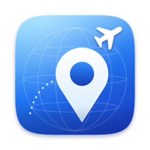
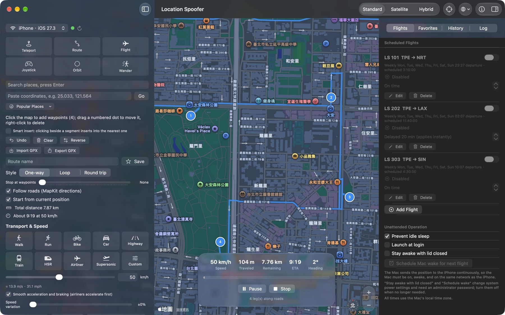
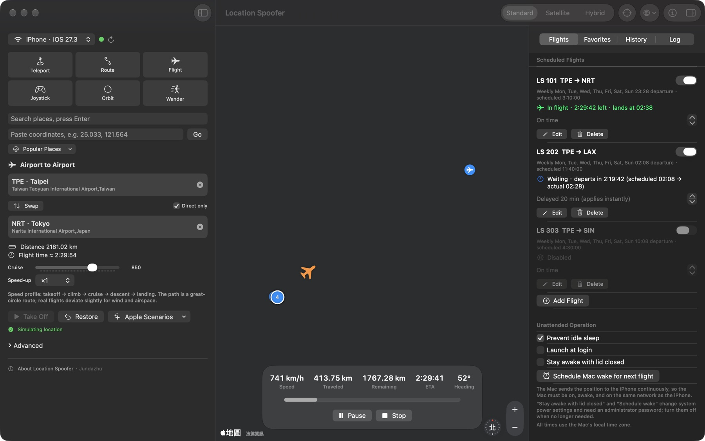
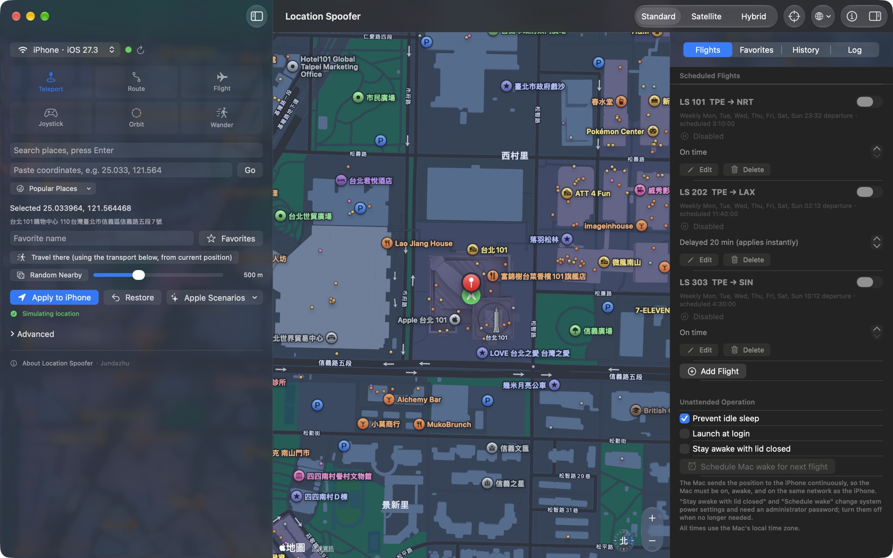
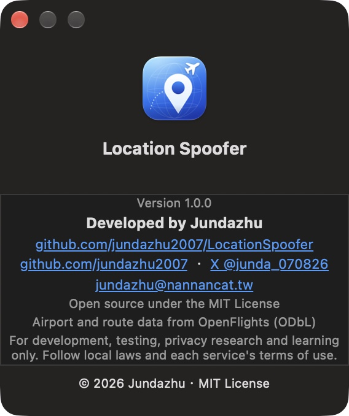

<div align="center">



# Location Spoofer

**Change an iPhone's location from your Mac — teleport, routes, joystick, orbit, wander, and airport‑to‑airport scheduled flights.**

[繁體中文](README.md) · [English](README.en.md) · [日本語](README.ja.md)

  

</div>

<p align="center"></p>

Built on Xcode's own `devicectl` (CoreDevice): **no jailbreak, no third‑party tools, no Python**, over USB or Wi‑Fi. Pure SwiftUI + MapKit with a macOS 26 Liquid Glass look, available in English, 繁體中文 and 日本語.

> For **development, testing, privacy research and learning** only. Follow local laws and the terms of the services you use (games, social, finance, …). The author is not responsible for misuse.

## Features

| Mode | What it does |
|---|---|
| **Teleport** | Click the map, search, or paste coordinates / a Google or Apple Maps link; popular places, random nearby, "travel there" |
| **Route** | Add waypoints on the map, **drag to edit**, right‑click to delete, smart insert; one‑way / loop / round trip, repeat N laps, stops at waypoints, follow roads (MapKit); GPX import / export |
| **Flight** | Pick departure and arrival airports (3,257 airports, 37,041 direct routes built in); great‑circle path with takeoff / climb / cruise / descent / landing speed profile |
| **Joystick** | Drag the joystick or use arrow keys / WASD |
| **Orbit** | Circle a center at a given radius, clockwise or not, for N laps |
| **Wander** | Random walk inside a radius |

Also:

- **Speed**: walk, run, bike, car, highway, train, high‑speed rail, airliner, supersonic and custom (1–3000 km/h); speed variation, GPS jitter, smooth acceleration / braking, time scale up to ×300
- **Scheduled flights**: flight number, airports, departure time, weekly or one‑time, scheduled duration; boards, departs and lands automatically; **delays can be edited any time and apply instantly** (departure shifts before takeoff, speed adapts in flight)
- **Unattended**: menu bar presence, launch at login, prevent sleep, scheduled Mac wake
- **Multiple devices**: sync to every connected iPhone / iPad
- Trail recording with GPX export, saved places and routes, history, Apple's built‑in scenarios
- Restores the real location when you quit

<p align="center">
<br>
 
</p>

## Requirements

- macOS 26+ and Xcode 26+ (developed with Xcode 27.2 / Swift 6.4)
- An iPhone / iPad with **Developer Mode** on (Settings → Privacy & Security → Developer Mode), paired with and trusting this Mac
- Tested on iOS 27.3; older versions should work in theory but are **untested**

## Download

Download **`LocationSpoofer-*-macOS-arm64.dmg`** (Apple silicon) from [Releases](https://github.com/jundazhu2007/LocationSpoofer/releases/latest), open it and drag the app to Applications. A `.zip` is also provided.

The app is not notarized (no Apple Developer account), so macOS blocks the first launch. Do one of:

- Open it once, then go to System Settings → Privacy & Security and click **Open Anyway**; or
- Run `xattr -dr com.apple.quarantine /Applications/LocationSpoofer.app` in Terminal.

To verify the download, compare `shasum -a 256` with the `SHA256SUMS.txt` attached to the release, or build from source (below). On an Intel Mac, build it yourself (`UNIVERSAL=1 ./build_app.sh`, **untested**).

## Build & run

```sh
git clone https://github.com/jundazhu2007/LocationSpoofer.git
cd LocationSpoofer
./build_app.sh          # builds LocationSpoofer.app (ad‑hoc signed)
open LocationSpoofer.app
```

If Gatekeeper blocks the first launch, right‑click the app → Open.

### Connecting the iPhone

1. Connect over USB once; unlock the iPhone and tap **Trust**.
2. Turn on Developer Mode.
3. After that it works **wirelessly** on the same Wi‑Fi (Xcode 27 no longer needs "Connect via network").
4. Pick the device at the top left; a green dot means connected.

## Usage

- **Language**: the globe icon in the toolbar switches instantly (Follow System / 繁體中文 / English / 日本語). "Follow System" respects macOS, including the per‑app language in System Settings → Language & Region → Apps.
- **Shortcuts**: ⌘↩ start / pause / resume, ⌘. stop, ⇧⌘R restore real location, ⇧⌘Z undo waypoint.
- **Menu bar**: shows status and flights; pause, stop, restore.
- **About**: toolbar ⓘ, the bottom of the left panel, or the app menu.

### Scheduled flights and unattended use

The Mac streams the position to the iPhone, so the Mac **must be on, awake, and on the same network as the iPhone**.

- "Prevent idle sleep", "Launch at login", "Schedule wake" and "Stay awake with lid closed" are in the Flights tab. The last two change system power settings and need an administrator password; **I have not tested them on hardware** — turn them off when not needed.
- If the Mac sleeps mid‑flight the position freezes; after waking it catches up to the current progress automatically.
- All times use the Mac's local time zone.
- **There is no live flight‑status feed**: enter delays manually and they apply immediately.

## Limitations

- `devicectl` can only set **latitude / longitude** — not altitude, speed or course.
- Each update takes about 0.8–2 s, so the position refreshes every 1–2 s; at high speeds each jump is larger.
- Flights follow a **great‑circle** path; real flights deviate for wind and airspace (import a real track as GPX in Route mode if you have one).
- Airport and route data come from a public dataset and may be incomplete or outdated.
- Some apps can detect simulated locations.

## Architecture

```
Sources/LocationSpoofer/
├── Models/          Geo (great‑circle math, PathTrack), Models, Airports (database, flight speed profile)
├── Services/        DeviceService (devicectl), LocationSender (serialized sending),
│                    RoutingService (MapKit), FlightScheduler, PowerService, GPX, LibraryStore
├── ViewModels/      MovementController (movement engine), AppModel
├── Views/           ContentView, ControlPanel, ScheduleView, LibrarySidebar, AboutPanel
├── Localization/    L(), AppLanguage, AppInfo
└── Demo/            screenshot mode (development only)
```

The movement engine computes the position from **real elapsed time × speed**, independent of `devicectl` latency; the sender always sends only the latest coordinate, so nothing queues up.

## Development

```sh
swift test                                  # unit tests
python3 scripts/localization.py check       # verify translations
swift scripts/make_icon.swift Resources     # regenerate the icon
```

See [CONTRIBUTING.md](CONTRIBUTING.md) for details.

## Author

Developed by **Jundazhu**.

- GitHub: [github.com/jundazhu2007](https://github.com/jundazhu2007)
- X: [@junda_070826](https://x.com/junda_070826)
- Email: [jundazhu@nannancat.tw](mailto:jundazhu@nannancat.tw)
- Repository: [jundazhu2007/LocationSpoofer](https://github.com/jundazhu2007/LocationSpoofer)

## License & data

Code is under the [MIT License](LICENSE). Airport and route data are derived from [OpenFlights](https://openflights.org/data.html) (ODbL) — see [THIRD_PARTY_NOTICES.md](THIRD_PARTY_NOTICES.md). Maps, search and directions come from Apple MapKit.
