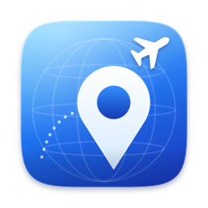
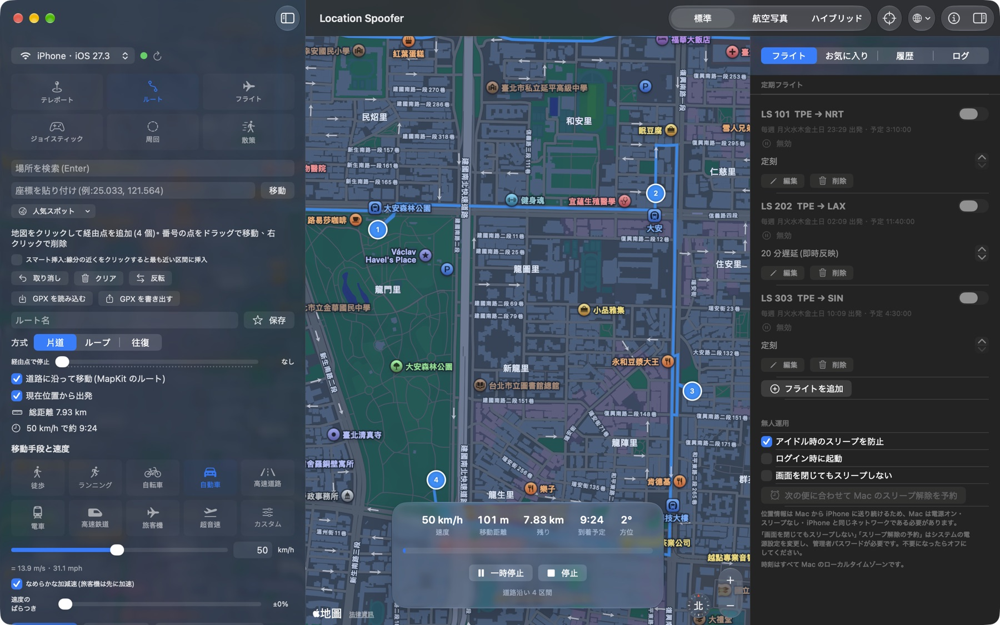
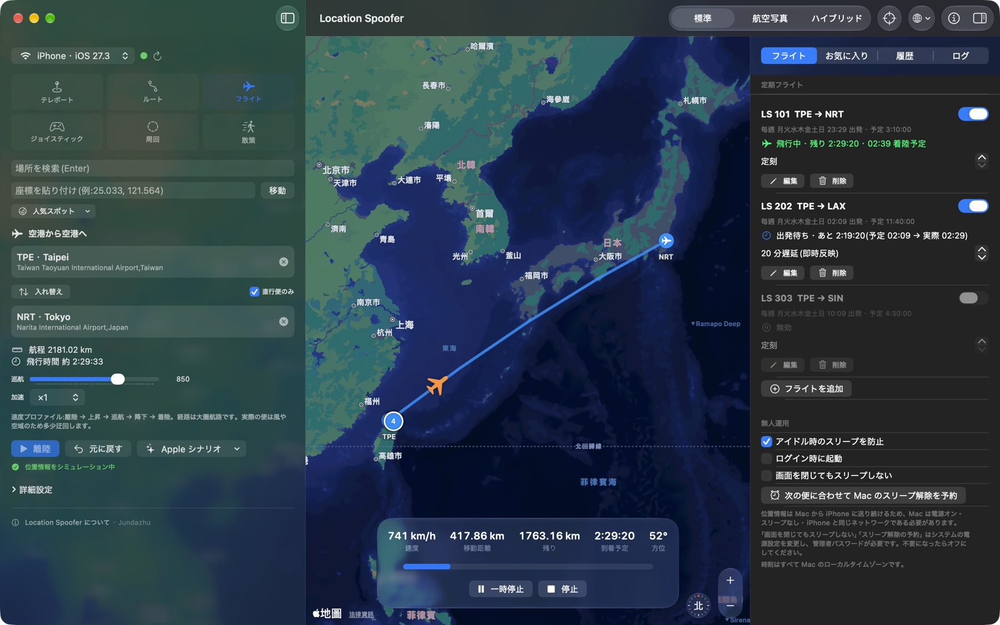
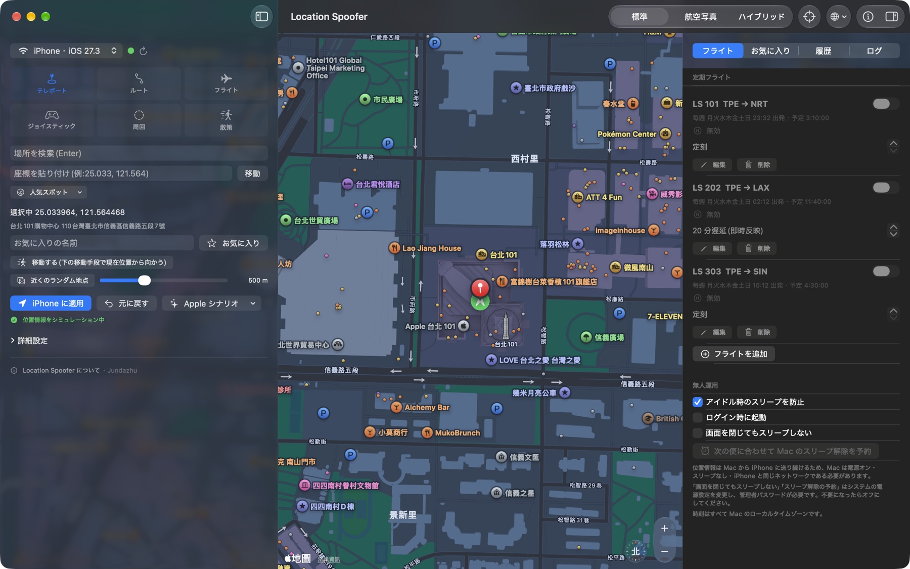
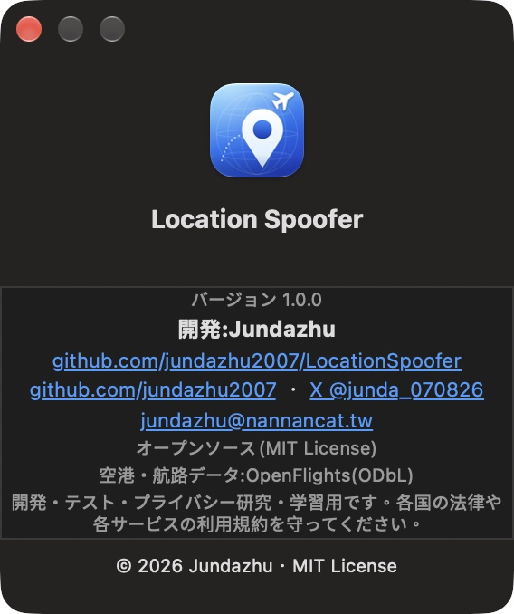

<div align="center">



# Location Spoofer

**Mac から iPhone の位置情報を変更 —— テレポート、ルート、ジョイスティック、周回、散策、そして空港から空港への定期フライト。**

[繁體中文](README.md) · [English](README.en.md) · [日本語](README.ja.md)

  

</div>

<p align="center"></p>

Xcode 標準の `devicectl`(CoreDevice)を使うので、**脱獄も、サードパーティ製ツールも、Python も不要**。USB と Wi‑Fi(ワイヤレス)に対応します。SwiftUI + MapKit のみで、macOS 26 の Liquid Glass デザイン。日本語・English・繁體中文に対応しています。

> **開発・テスト・プライバシー研究・学習**用です。各国の法律や各サービス(ゲーム、SNS、金融など)の利用規約を守ってください。悪用による結果について作者は責任を負いません。

## 機能

| モード | 内容 |
|---|---|
| **テレポート** | 地図クリック、検索、座標や Google / Apple マップのリンクの貼り付け。人気スポット、近くのランダム地点、「移動する」 |
| **ルート** | 地図で経由点を追加し、**ドラッグで編集**、右クリックで削除、スマート挿入。片道 / ループ / 往復、N 周繰り返し、経由点での停止、道路沿い(MapKit)、GPX の読み込み・書き出し |
| **フライト** | 出発・到着空港を選択(3,257 空港、37,041 の直行路線を内蔵)。大圏航路と、離陸・上昇・巡航・降下・着陸の速度プロファイル |
| **ジョイスティック** | ジョイスティックのドラッグ、または矢印キー / WASD |
| **周回** | 中心と半径で周回(向き・周回数を指定可) |
| **散策** | 半径内をランダムに移動 |

その他:

- **速度**:徒歩、ランニング、自転車、自動車、高速道路、電車、高速鉄道、旅客機、超音速、カスタム(1〜3000 km/h)。速度のばらつき、GPS ゆらぎ、なめらかな加減速、時間加速(最大 ×300)
- **定期フライト**:便名、空港、出発時刻、毎週 / 1 回のみ、予定飛行時間を設定。時刻になると自動で搭乗・離陸・着陸。**遅延はいつでも変更でき、すぐに反映**(離陸前は出発が繰り下がり、飛行中は速度を自動調整)
- **無人運用**:メニューバー常駐、ログイン時に起動、スリープ防止、Mac のスリープ解除の予約
- **複数デバイス**:接続中のすべての iPhone / iPad に同期
- 軌跡の記録と GPX 書き出し、お気に入り、履歴、Apple 標準シナリオ
- 終了時に実際の位置情報へ自動復元

<p align="center">
<br>
 
</p>

## 必要環境

- macOS 26 以上、Xcode 26 以上(開発環境:Xcode 27.2、Swift 6.4)
- **デベロッパモード**をオンにし、この Mac とペアリング・信頼済みの iPhone / iPad(設定 → プライバシーとセキュリティ → デベロッパモード)
- iOS 27.3 で動作確認。それ以前のバージョンは理論上動作しますが**未確認**です

## ダウンロード

[Releases](https://github.com/jundazhu2007/LocationSpoofer/releases/latest) から `LocationSpoofer-*-macOS-arm64.zip`(**Apple シリコン**)をダウンロードして解凍し、アプリケーションフォルダに移動します。

Apple Developer アカウントがないため公証(notarize)されておらず、初回起動は macOS にブロックされます。次のいずれかで許可してください:

- 一度開いたあと、システム設定 → プライバシーとセキュリティで「このまま開く」をクリック
- ターミナルで `xattr -dr com.apple.quarantine /Applications/LocationSpoofer.app` を実行

ダウンロードの確認には、リリースに添付の `SHA256SUMS.txt` と `shasum -a 256` の結果を比較するか、ソースからビルドしてください(下記)。Intel Mac では自分でビルドしてください(`UNIVERSAL=1 ./build_app.sh`、**未検証**)。

## ビルドと実行

```sh
git clone https://github.com/jundazhu2007/LocationSpoofer.git
cd LocationSpoofer
./build_app.sh          # LocationSpoofer.app を生成(ad-hoc 署名)
open LocationSpoofer.app
```

初回起動が Gatekeeper にブロックされたら、アプリを右クリック → 開く。

### iPhone の接続

1. 初回は USB で接続し、iPhone のロックを解除して「信頼」をタップ。
2. デベロッパモードをオンにする。
3. 以降は同じ Wi‑Fi で**ワイヤレス**で使えます(Xcode 27 では「ネットワーク経由で接続」のチェックは不要)。
4. 左上でデバイスを選択。緑の点は接続済みです。

## 使い方

- **言語**:ツールバーの地球アイコンで即時に切り替え(システムに従う / 繁體中文 / English / 日本語)。「システムに従う」は macOS の言語設定(「システム設定 → 言語と地域 → アプリ」の個別設定を含む)に従います。
- **ショートカット**:⌘↩ 開始 / 一時停止 / 再開、⌘. 停止、⇧⌘R 実際の位置情報に戻す、⇧⌘Z 経由点を取り消す。
- **メニューバー**:状態とフライトを表示。一時停止・停止・復元ができます。
- **このアプリについて**:ツールバーの ⓘ、左パネル下部、またはアプリメニュー。

### 定期フライトと無人運用

位置情報は Mac から iPhone へ送り続けるため、Mac は**電源オン・スリープなし・iPhone と同じネットワーク**である必要があります。

- 「アイドル時のスリープを防止」「ログイン時に起動」「スリープ解除の予約」「画面を閉じてもスリープしない」は「フライト」タブにあります。後者 2 つはシステムの電源設定を変更し管理者パスワードが必要です。**実機では未検証**です。不要なときはオフにしてください。
- 飛行中に Mac がスリープすると位置は止まります。復帰後は時間に基づき自動で追いつきます。
- 時刻はすべて Mac のローカルタイムゾーンです。
- **リアルタイムの運航情報には未対応**です。遅延は手動で入力し、すぐに反映されます。

## 制限

- `devicectl` で設定できるのは**緯度・経度のみ**で、高度・速度・進行方向は指定できません。
- 1 回の送信に約 0.8〜2 秒かかるため、位置の更新は 1〜2 秒ごとです。高速移動では 1 回あたりの移動量が大きくなります。
- フライト経路は**大圏航路**です。実際の便は風や空域のため多少迂回します(実際の軌跡の GPX があればルートモードで読み込めます)。
- 空港・路線データは公開データセット由来で、欠落や古い情報を含む場合があります。
- 一部のアプリはシミュレーションされた位置情報を検出できます。

## 構成

```
Sources/LocationSpoofer/
├── Models/          Geo(大圏計算、PathTrack)、Models、Airports(空港DB、飛行速度プロファイル)
├── Services/        DeviceService(devicectl)、LocationSender、RoutingService(MapKit)、
│                    FlightScheduler、PowerService、GPX、LibraryStore
├── ViewModels/      MovementController(移動エンジン)、AppModel
├── Views/           ContentView、ControlPanel、ScheduleView、LibrarySidebar、AboutPanel
├── Localization/    L()、AppLanguage、AppInfo
└── Demo/            スクリーンショットモード(開発用)
```

移動エンジンは「**実際の経過時間 × 速度**」で位置を計算するため、`devicectl` の遅延に影響されません。送信側は常に最新の座標だけを送るので、処理が溜まりません。

## 開発

```sh
swift test                                  # 単体テスト
python3 scripts/localization.py check       # 翻訳の漏れを確認
swift scripts/make_icon.swift Resources     # アイコンを再生成
```

詳しくは [CONTRIBUTING.md](CONTRIBUTING.md) をご覧ください。

## 作者

**Jundazhu** が開発しました。

- GitHub:[github.com/jundazhu2007](https://github.com/jundazhu2007)
- X:[@junda_070826](https://x.com/junda_070826)
- Email:[jundazhu@nannancat.tw](mailto:jundazhu@nannancat.tw)
- リポジトリ:[jundazhu2007/LocationSpoofer](https://github.com/jundazhu2007/LocationSpoofer)

## ライセンスとデータ

コードは [MIT License](LICENSE)。空港・路線データは [OpenFlights](https://openflights.org/data.html)(ODbL)から派生したものです。詳細は [THIRD_PARTY_NOTICES.md](THIRD_PARTY_NOTICES.md) を参照してください。地図・検索・経路案内は Apple MapKit によるものです。
