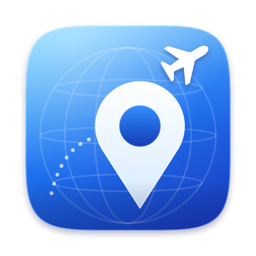
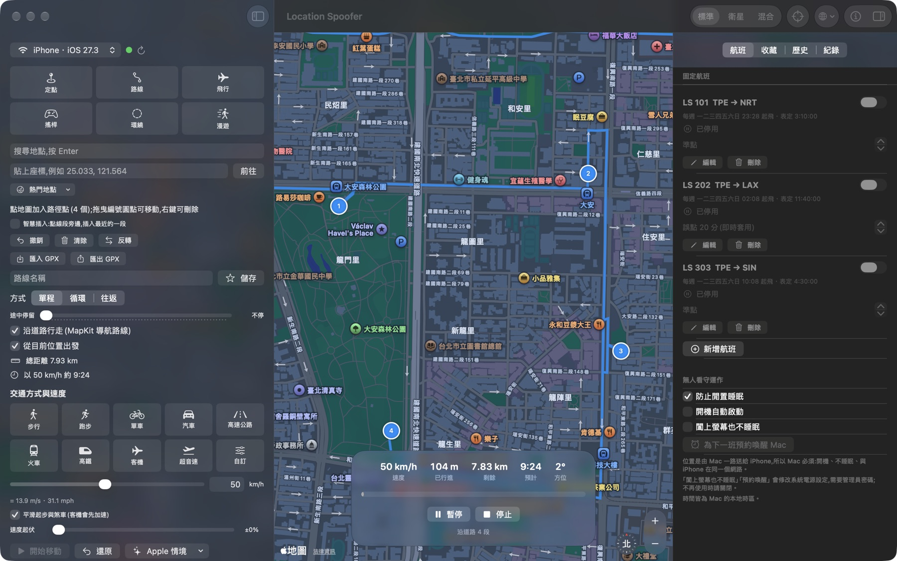
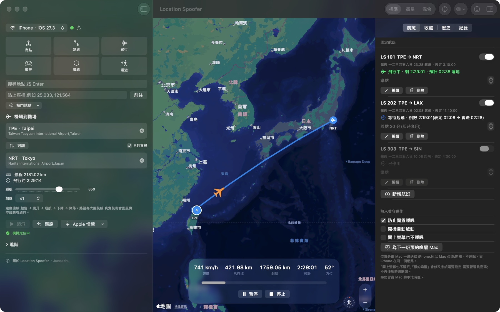
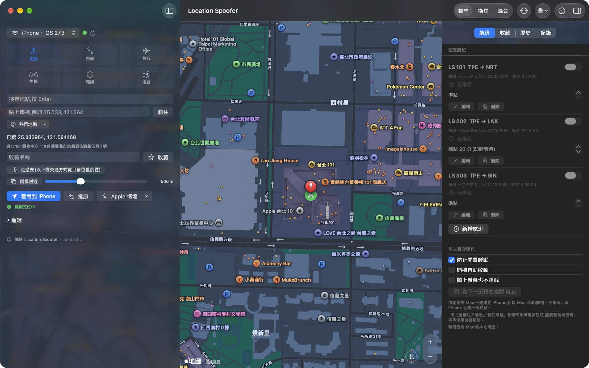
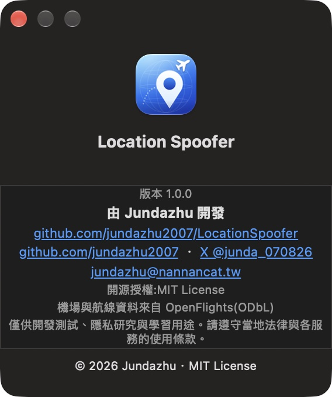

<div align="center">



# Location Spoofer

**用 Mac 修改 iPhone 的定位 —— 定點、路線、搖桿、環繞、漫遊,以及機場到機場的固定航班。**

[繁體中文](README.md) · [English](README.en.md) · [日本語](README.ja.md)

  

</div>

<p align="center"></p>

使用 Xcode 內建的 `devicectl`(CoreDevice),**不需要越獄、不需要安裝任何第三方工具、不需要 Python**,支援 USB 與 Wi‑Fi 無線連線。純 SwiftUI + MapKit,介面為 macOS 26 的 Liquid Glass 風格,支援繁體中文、English、日本語。

> 本專案僅供**開發測試、隱私研究與學習**用途。請遵守當地法律與各服務(遊戲、社群、金融等)的使用條款,對於濫用造成的後果,作者概不負責。

## 功能

| 模式 | 說明 |
|---|---|
| **定點** | 點地圖、搜尋、貼上座標或 Google / Apple 地圖連結,一鍵傳送;熱門地點、隨機附近、走過去 |
| **路線** | 點地圖加入路徑點,**拖曳圓點即可編輯**、右鍵刪除、智慧插入;單程 / 循環 / 往返、重複 N 圈、途中停留、沿道路行走(MapKit 導航);匯入 / 匯出 GPX |
| **飛行** | 選出發與抵達機場(內建 3,257 個機場、37,041 組直飛航線),大圓航線 + 起飛 / 爬升 / 巡航 / 下降 / 降落速度曲線 |
| **搖桿** | 拖曳搖桿或方向鍵 / WASD 即時移動 |
| **環繞** | 以圓心與半徑繞圈,可設定順 / 逆時針與圈數 |
| **漫遊** | 在半徑內隨機走動 |

另外還有:

- **速度**:步行、跑步、單車、汽車、高速公路、火車、高鐵、客機、超音速與自訂(1–3000 km/h)、速度起伏、GPS 抖動、平滑起步與煞車、時間加速(最高 ×300)
- **固定航班**:設定航班號、機場、起飛時刻、每週重複或單次、表定飛行時間;到點自動登機、起飛、落地;**誤點可隨時修改並立即套用**(起飛前順延起飛,飛行中自動調整速度)
- **無人看守**:選單列常駐、開機自動啟動、防止睡眠、預約喚醒 Mac
- **多裝置**:同步到所有已連線的 iPhone / iPad
- 軌跡錄製與 GPX 匯出、收藏地點與路線、歷史紀錄、Apple 內建情境(City Run 等)
- 結束 app 時自動還原真實定位

<p align="center">
<br>
 
</p>

## 需求

- Apple 晶片的 Mac、macOS 26 以上、Xcode 26 以上(開發環境:Xcode 27.2、Swift 6.4)
- 一支 iPhone / iPad,已開啟**開發者模式**(設定 → 隱私權與安全性 → 開發者模式),並已與這台 Mac 配對、信任
- 已在 iOS 27.3 實測;更舊的版本理論上可行但**未測試**

## 下載

到 [Releases](https://github.com/jundazhu2007/LocationSpoofer/releases/latest) 下載 **`LocationSpoofer-*-macOS-arm64.dmg`**(Apple 晶片),開啟後把 app 拖進「應用程式」。也提供 `.zip` 版本。

因為沒有 Apple 開發者帳號,app 無法公證,第一次開啟會被 macOS 擋下。請擇一:

- 開啟一次後,到「系統設定 → 隱私權與安全性」,按「仍要打開」;或
- 在終端機執行:`xattr -dr com.apple.quarantine /Applications/LocationSpoofer.app`

想自己確認內容,可用 `shasum -a 256` 比對 Release 附的 `SHA256SUMS.txt`,或直接從原始碼建置(見下)。**僅支援 Apple 晶片的 Mac,不提供 Intel 版。**

## 建置與執行

```sh
git clone https://github.com/jundazhu2007/LocationSpoofer.git
cd LocationSpoofer
./build_app.sh          # 產生 LocationSpoofer.app(ad-hoc 簽名)
open LocationSpoofer.app
```

第一次開啟若被 Gatekeeper 擋下,請在 app 上按右鍵 → 打開。

### 連接 iPhone

1. 第一次先用 USB 連接,iPhone 解鎖並點「信任」。
2. 開啟開發者模式。
3. 之後同一個 Wi‑Fi 下即可**無線**使用(Xcode 27 不需要再勾選「Connect via network」)。
4. 在 app 左上角選擇裝置,綠點表示已連線。

## 使用

- **語言**:工具列的地球圖示可即時切換(跟隨系統 / 繁體中文 / English / 日本語);選擇「跟隨系統」時會依 macOS 語言,包含「系統設定 → 語言與地區 → App」的個別設定。
- **快捷鍵**:⌘↩ 開始 / 暫停 / 繼續、⌘. 停止、⇧⌘R 還原真實定位、⇧⌘Z 撤銷路徑點。
- **選單列**:顯示目前狀態與航班,可暫停、停止、還原。
- **關於**:工具列的 ⓘ、左側面板底部或應用程式選單。

### 固定航班與無人看守

位置是由 Mac 一路送給 iPhone,所以 Mac **必須開機、不睡眠、與 iPhone 在同一個網路**。

- 「防止閒置睡眠」「開機自動啟動」「預約喚醒」「闔上螢幕也不睡眠」都在「航班」分頁。後兩者會修改系統電源設定、需要管理員密碼,**這部分我沒有實機測試**,不用時請關閉。
- 飛到一半 Mac 睡著,位置會停在原地;醒來後會依時間自動追上目前進度。
- 時間皆為 Mac 的本地時區。
- **沒有串接即時航班資料**:誤點需手動輸入,輸入後立刻生效。

## 限制

- `devicectl` 只能設定**經緯度**,無法指定海拔、速度與行進方向欄位。
- 每次送出座標約需 0.8–2 秒,所以位置約每 1–2 秒更新一次;高速時每次跳躍的距離較大。
- 飛行路徑是**大圓航線**,真實航班會因風與空域略有繞行(若有真實軌跡 GPX,可用路線模式匯入)。
- 機場與航線資料來自公開資料集,可能缺漏或過時。
- 有些 app 能偵測模擬定位。

## 架構

```
Sources/LocationSpoofer/
├── Models/          Geo(大圓計算、PathTrack)、Models、Airports(機場資料庫、飛行速度曲線)
├── Services/        DeviceService(devicectl)、LocationSender(序列化送出)、
│                    RoutingService(MapKit 路徑)、FlightScheduler(固定航班)、PowerService、GPX、LibraryStore
├── ViewModels/      MovementController(移動引擎)、AppModel
├── Views/           ContentView、ControlPanel、ScheduleView、LibrarySidebar、AboutPanel
├── Localization/    L()、AppLanguage、AppInfo
└── Demo/            截圖模式(僅開發用)
```

移動引擎依「**真實經過時間 × 速度**」計算位置,與 `devicectl` 的延遲無關;送出層永遠只送最新座標,所以不會堆積。

## 開發

```sh
swift test                                  # 單元測試
python3 scripts/localization.py check       # 檢查翻譯是否完整
swift scripts/make_icon.swift Resources     # 重新產生圖示
```

更多細節請見 [CONTRIBUTING.md](CONTRIBUTING.md)。

## 作者

由 **Jundazhu** 開發。

- GitHub:[github.com/jundazhu2007](https://github.com/jundazhu2007)
- X:[@junda_070826](https://x.com/junda_070826)
- Email:[jundazhu@nannancat.tw](mailto:jundazhu@nannancat.tw)
- 倉庫:[jundazhu2007/LocationSpoofer](https://github.com/jundazhu2007/LocationSpoofer)

## 授權與資料來源

程式碼採 [MIT License](LICENSE)。機場與航線資料衍生自 [OpenFlights](https://openflights.org/data.html)(ODbL),詳見 [THIRD_PARTY_NOTICES.md](THIRD_PARTY_NOTICES.md)。地圖、搜尋與導航由 Apple MapKit 提供。
